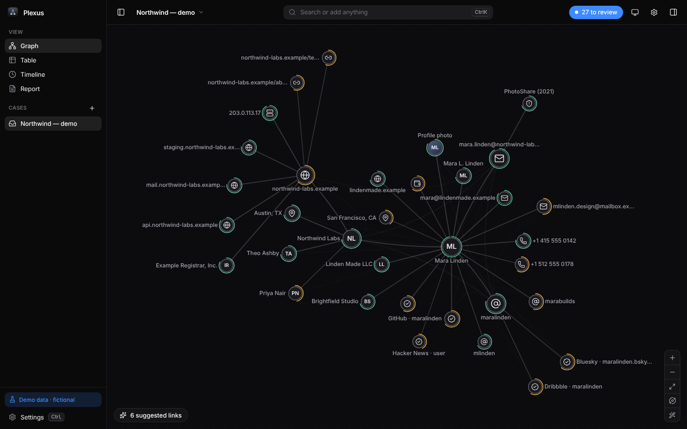
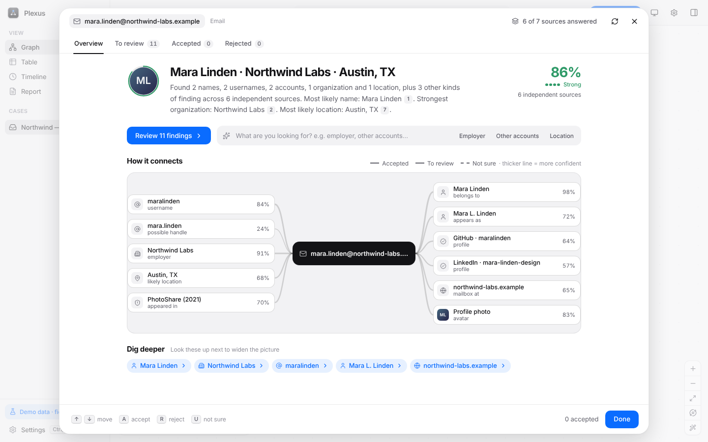
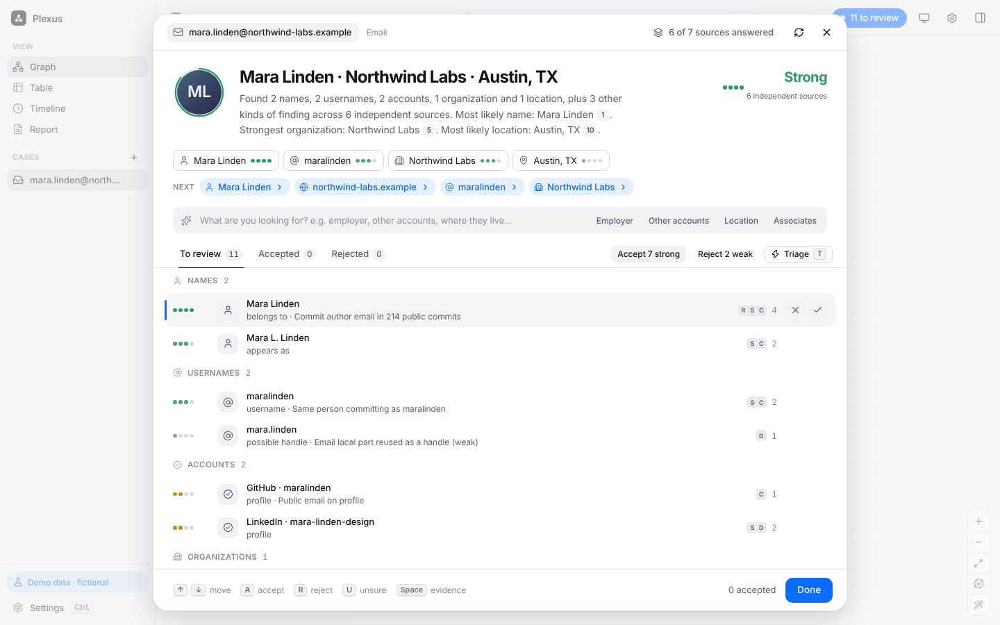
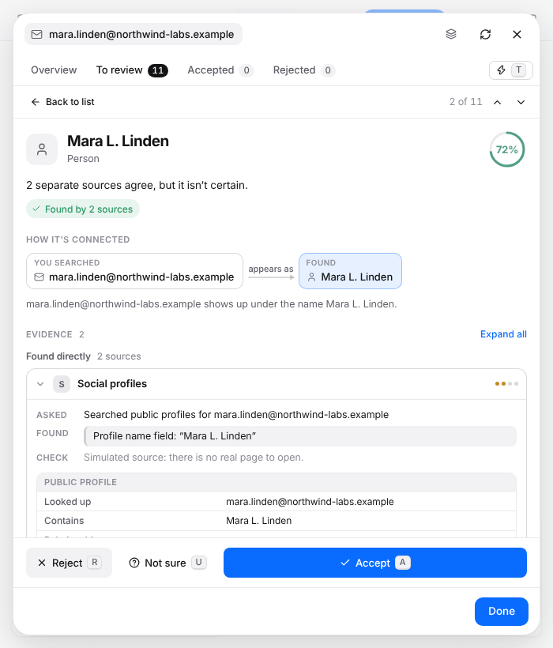
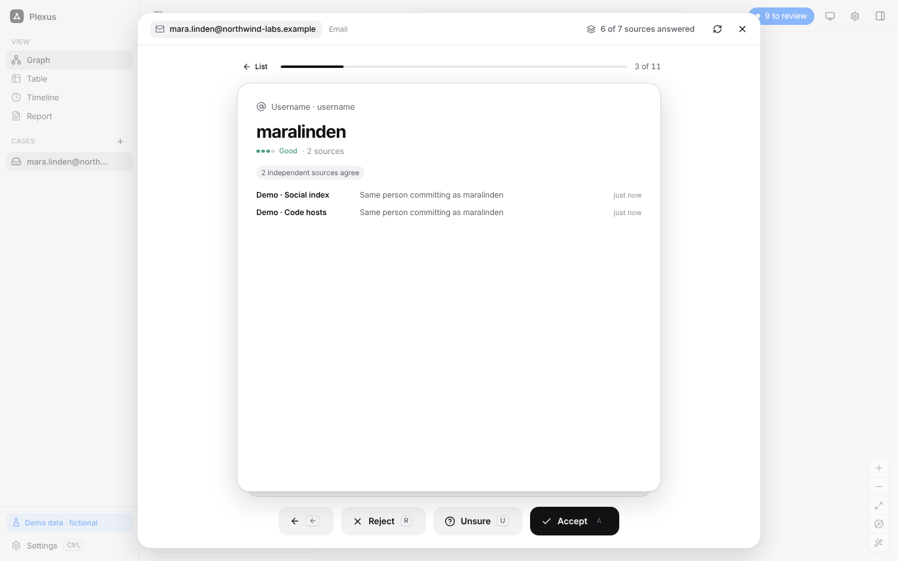

# Plexus

A local-first investigation workbench. Enter one fact (an email, username, domain, name, phone, IP or wallet) and Plexus gathers what is publicly connected to it, **scores how likely each finding is to be true**, lets you confirm the ones that matter in seconds, and draws the result as a graph.



|  |  |
|---|---|
|  |  |
|  |  |

Everything stays on your machine: cases and findings in SQLite, API keys in a private file, and a per-case audit log of every lookup and export.

---

## Run it

Requires **Node 22.13+** (uses the built-in `node:sqlite`, so there are no native modules to compile).

```bash
npm install
npm run dev        # API on :4317, web UI on http://localhost:5173 (hot reload)
```

```bash
npm start          # production build, then serve everything on http://localhost:4317
npm test           # 349 unit/integration tests
npm run typecheck
```

First launch offers **demo data**: a fictional cast on reserved `.example` domains with deliberately noisy records (conflicting cities, a namesake, stale numbers). It runs fully offline, so you can learn the whole workflow without touching a real source.

### Install as a Mac app

```bash
git clone -b claude/wizardly-johnson-cwj8ub https://github.com/CJDavis30/Test.git ~/Plexus
cd ~/Plexus && ./scripts/mac/install.sh
```

Needs Node 22.13+ (`brew install node`) and git. The script builds **Plexus.app** into `/Applications` (or `~/Applications`), gives it the icon, signs it ad-hoc so it runs on Apple Silicon (no Apple Developer account needed), and opens it. Keep the `~/Plexus` folder: it is what updates are built from.

**Updating.** Either use **Plexus menu → Check for Updates…** (it also checks quietly once a day and only speaks up if something is new), or run `./scripts/mac/update.sh`. Both do `git pull`, rebuild, replace the app and reopen it. If a step fails the installed app is left untouched and you get an alert. Your cases live in `~/.plexus`, separate from the app, so updates never touch them. `./scripts/mac/uninstall.sh` removes the app (`--purge` also deletes your cases).

How it runs: the window talks to a local engine that the app starts with your system Node (found at install time, since GUI apps don't inherit your shell PATH), reusing one if it is already running. Logs: `~/Library/Logs/Plexus`. The icon source is `assets/icon/icon.svg`.

---

## How a lookup works

```
input ─► detect type ─► run sources (fallback chains) ─► merge by canonical key
                                                              │
         graph ◄─ you review & accept ◄─ score + conflicts ◄──┘
                                              │
                                  brief (rules, optionally AI with checked citations)
```

1. **Detect.** `jane@acme.com`, `@jdoe`, `acme.com`, `+1 415…`, `185.12.4.9`, `Doe, Jane`, `Austin, TX` are all typed automatically. Press `⇥` to correct a guess. Paste a whole list and each line is typed.
2. **Query sources.** Sources that answer the same question form a **fallback chain**: they are tried in priority order and the next one runs if the previous fails, returns nothing, or is rate-limited. Sources that return different data (e.g. username checks) all run. Results stream in as each source answers.
3. **Merge.** Claims from different sources about the same thing collapse into one finding by canonical key (`Jane.Doe+x@gmail.com` = `janedoe@gmail.com`, `Doe, Jane` = `Jane Doe`, tracking params stripped). Rejected findings are never resurrected by a re-run.
4. **Score.** See below.
5. **Review.** Four tabs: **Overview** (a two-line summary, the overall confidence, a map of how everything connects, and what to dig into next), **To review** (a ranked list with a details panel beside it), **Accepted** and **Rejected**. In the details panel the confidence and how it was reached sit at the top, then the chain *what you searched → how it relates → what was found*, then one compact row per source that opens to show exactly what was asked, what came back, the record's fields and a link to check it yourself. Accept / Reject / Not sure stay pinned at the bottom. In a narrow window the details slide over the list (with Back and ‹ › buttons) and the sidebar becomes a drawer, so nothing ever disappears. Accepted findings become nodes and evidenced edges.
6. **Connect.** The graph uses an **organized layout** by default (see below). Deterministic link suggestions (same handle as an email, profile URL ↔ username, name variants → "possibly the same", people sharing an employer, subdomain families), shortest strongest-evidence path between any two nodes, optional AI hypotheses.

### The graph layout

Graphs get hairy because every finding links back to a hub and hubs share neighbours. Plexus avoids that structurally instead of hoping a physics simulation untangles it:

- **A tidy radial tree.** The strongest-evidence spanning tree of each connected group is the skeleton. The best-connected entity sits at the centre, its children on a ring grouped by type (emails together, accounts together…), deeper levels fanning out. Crowded rings stagger onto two radii. A relaxation pass guarantees a minimum gap between neighbours, and tests assert that nothing overlaps at 8, 30, 56, 120 and 300 nodes.
- **Cross-links are quiet.** Links that aren't part of the skeleton are drawn as faint arcs bundled toward the centre, and light up (with their label) only when you select or hover either end. Selecting a node dims everything unrelated.
- **Labels never collide.** They sit *outward* from their node, every node circle and earlier label is an obstacle, each label tries alternative positions, and the least important are dropped (they reappear as you zoom in).
- **Direct manipulation.** Drag a node and its whole branch comes with it (hold ⌥ to move just one); it stays pinned, and pins survive reloads. **Tidy up** (zoom controls, right-click, or ⌘K) releases every pin. A toggle switches to a free-form force layout if you prefer it.
- Line widths have a floor in screen pixels, so large graphs stay visible when zoomed out. 700 entities / 1,200 links render at 60 fps.

### How evidence is checked

A finding is not trusted because one source said so. Each one shows its trail, and then Plexus tries to break it:

- **Found directly.** For every source: *what was asked* ("Searched public TLS certificate logs for names under example.com"), *what came back* (the source's own record, quoted field by field: display name, public email, registrar, breach date…), and **a link**: the exact record page when the source gives one, otherwise a page where you can repeat the same lookup yourself. Simulated and offline sources say so instead of showing a dead link.
- **Cross-checks.** After the first answers arrive, Plexus asks *other* sources about what it found and compares. Three outcomes, each added as evidence quoting what the other source returned:
  - **Links back**: the account's profile lists the email you searched.
  - **Shared detail**: the same name, city, employer or photo appears on that profile, which corroborates *both* findings.
  - **Contradicts**: the profile shows a different name or place than the one we're now fairly sure of. That counts *against* the finding and lowers its score. Famous-person and namesake flags are never counted as corroboration.
  Sources that were asked and had nothing are listed as such, never as confirmation. Cross-checking uses a few extra requests per lookup (capped) and can be turned off in Settings.
- **The score** (e.g. 87%) is shown with its breakdown: found directly by N sources · N cross-checks confirm · N contradict · asked with no answer. Two views of the same dataset count once, so a second question to the same source is never a second opinion. Weak or disputed findings are worded as "Unconfirmed." / "Disputed." instead of being stated as fact.

### How confidence is calculated

No fake precision: the UI shows four levels (Weak / Fair / Good / Strong) and *why*.

- Each piece of evidence has a claim strength × the source's **reliability**. `belief = 1 − Π(1 − pᶠ)` over independent **families**: two scrapers of the same dataset count once, two unrelated sources compound.
- **Contradictions** (a cross-check found a different owner, name or place) cut a finding's score hard but cannot erase support from several strong, independent sources, so a disputed finding stays visible and labelled instead of vanishing.
- **Conflicts**: two competing single-valued claims (two home cities) are linked; the weaker is demoted and both are flagged.
- **Context re-ranks, it never inflates truth.** Typing "employer" lifts organizations in the *order* but leaves their confidence untouched.
- **It learns from you.** Every accept/reject nudges that source's reliability for that entity type (a Bayesian blend of the prior and your decisions, fully undoable). Settings → Sources shows each source's learned trust and how many decisions it rests on.

### Measured accuracy

`test/calibration.test.ts` runs five lookups across the demo world, which has known ground truth and deliberate false leads (a namesake, her handle, a holiday location), and scores the result: **precision 1.00 where Plexus says "likely", recall 1.00 on real findings, AUC 1.000** (every true finding outranks every false lead; the best false lead scores 37%, the weakest true finding 40%). It also checks that no confidence band overclaims and that bands are ordered. Absolute calibration is deliberately *not* asserted: the demo world is about 95% true, so it would only reflect that base rate. Tuning from this benchmark raised the contradiction penalty after it showed a handle owned by a namesake still scoring 43%. Run it with `npx vitest run test/calibration.test.ts`; the table prints in verbose mode.

### Reliability

- **Circuit breaker.** A source that fails three times in a row is paused (30 s, doubling to 15 min); lookups skip it and the next source in its fallback chain answers immediately instead of everyone waiting on a timeout. After the cooldown one trial call decides. Rate limits, missing keys and cancelled runs never count against a source. Settings → Sources shows *Paused until…* with a **Resume** button, and a passing **Test** resumes it too.
- **Retries** for transient network errors: two retries with exponential backoff and jitter. Cached answers never touch a paused source.

### Portability

- **Import** any Plexus export as a *new* case (nothing is overwritten; ids are re-issued so importing twice is safe). Evidence fingerprints are carried over, so tampering with the file shows up as "altered". Hostile files are validated and capped.
- **Exports:** Markdown, printable **HTML** (Print → Save as PDF, with the integrity section), **GraphML** (Gephi, yEd, Cytoscape), **CSV** (entities and relationships, spreadsheet-safe) and full JSON. Redacted exports mask names, notes, quotes and links.
- **Search across every case** from ⌘K, and a **shortcuts list** on `?`.

### Forensics: what identifiers, clocks and statistics can tell you

Everything here is computed on this Mac from public data and from the identifiers themselves. Each technique states its assumptions in the interface and is tested against simulations where the true answer is known.

| Technique | What it does | Measured |
|---|---|---|
| **Platform ID decoding** | Discord, Twitter/X and Instagram IDs are timestamps; Steam IDs name their account type; Minecraft UUIDs show whether Mojang or a cracked server issued them. A scanner finds every platform link and ID in pasted text and decodes it. | Exact: matches Discord's documented example, a known Steam ID, and platform MD5/SHA-256 on awkward lengths. |
| **Match Lab (same operator?)** | Fellegi–Sunter record linkage. Every signal (handle, creation time, shared contact, avatar, self-link, active hours, alternation) is a likelihood ratio in **bits**; prior odds plus the sum gives the probability. Drag the prior and watch the answer move. | Account-creation coincidence is a proper likelihood ratio: its average over unrelated pairs is 1. Calibrated against its own generative model. A copied handle is capped at 8 bits, because copying is easy. |
| **Circadian fingerprint** | Turns any timestamps (message links, commits, logs, public feeds) into a probability over timezones, with an Activity Clock. | Stated confidence tracks accuracy: 70% stated is right 68% of the time at 80 sittings; 97% vs 96% at 320. |
| **Daylight-saving fingerprint** | Whether the clocks change where this person lives, and in which hemisphere. | Calibrated; honest "not enough data" when only one season is present. |
| **Alternation test** | One person takes turns between accounts; two people overlap. | Flags one-operator pairs in at least 80% of simulations; false link rate at most 5%. |
| **Creation bursts** | A scan statistic over account creation times: three accounts in one minute is a pattern, with its p-value. | False alarms at most 1% on random data. |
| **Identities** | Groups accounts into operators, keeps namesakes and look-alikes apart, and lists "might be the same" for a human. | Property-tested: symmetric, monotone, every profile in exactly one group. |
| **Stress test** | Re-scores every conclusion with each source removed: what survives if one source is wrong? A *Stress map* on the graph rings the conclusions that hang on one source. | Tested: removing evidence never raises a score. |
| **Bits ledger** | For any finding, the chance every independent source is wrong at once; equals the score exactly (belief = 1 − 2^−bits). | Identity checked in tests. |
| **Next best move** | Expected information gain picks the check that would teach you the most and predicts what it would show. | Tested: gain peaks at 50/50, is never negative, and the expected posterior equals the prior. |
| **Email header forensics** | Route, hop timing, the sender's own timezone, SPF/DKIM/DMARC, forged-timeline checks. | Unit-tested on a realistic header and on forged ones. |
| **Chat export importer** | Open a Discord (JSON/CSV), Telegram (JSON) or WhatsApp (text) export in Decode: every speaker gets a message count, an activity clock and a timezone estimate, and the busy ones can be added to the case in one click. | Unit-tested on all four formats, including malformed and empty input. |
| **Self-calibrating ID clocks** | Roblox and GitHub IDs grow with time but not at a published rate. Plexus learns the ID→date curve from the accounts it has actually fetched (monotone fit) and dates a bare ID with an honest band. | Band is the 90th-percentile leave-one-out error ×1.6; refuses to guess with fewer than 6 anchors. |
| **Roblox depth + Discord invites** | Roblox: earlier usernames (real leads, weighted modestly because freed names get reused), friend and follower counts shown for context but never scored. Discord: a public invite link resolves to the server name, creation date (from its ID), size and who made the invite. | Fixture-tested (no live calls from this sandbox); a failing side endpoint never costs the main profile. |
| **Case health** | One score for how well-supported the case is: independent sources, how much hangs on a single source, unresolved conflicts, stale evidence. Opens to show each part and what would improve it. | Unit-tested. |
| **Staleness** | Old observations are flagged as such on the finding instead of silently looking current. | Unit-tested. |

**Autopilot** follows the strongest leads on its own and builds the graph while you watch. It accepts only what several independent sources agree on and nothing disputes, never follows guesses or bare names, logs everything, and can be **undone** in one click or run as a **dry run** first.

**Signed evidence package** (⌘K → *Save signed evidence package*): one HTML file containing the evidence, an Ed25519 signature, and code that recomputes every fingerprint and verifies the signature in the reader's own browser, with a built-in SHA-256 fallback. Verified in a real browser, including that changing one quote is detected. The signing key lives in a 0600 file on your Mac.

**Safeguards for young people.** Roblox and Discord are full of children. If a source shows what a subject says about their own age or school (never inferred from behaviour), Plexus flags the case, holds back from steps that point toward a real name, number, email or place, asks before you accept one, and points to reporting instead (platform safety forms, the police, NCMEC in the US). It can be wrong either way, so a person can override it and the override is logged. Live lookups also ask for a purpose once per case, written to the tamper-evident log; both can be turned off in Settings.

### Integrity and safety (chain of custody)

- **Evidence fingerprints.** Every observation is sealed with a SHA-256 hash of exactly what Plexus recorded: the source, the question asked, the page, the quote, the record fields and the time. The fingerprint shows on each evidence row and in reports, and is re-checked on demand. The hash covers the *recorded* observation, not the raw network response, so it proves nothing was altered after capture, not that the source was truthful.
- **Tamper-evident activity log.** Each audit entry carries a hash that covers the entry before it. Editing or removing an entry breaks the chain, and **Settings → Audit log → Verify** names the first entry that no longer fits. Entries from before chaining are reported as legacy, never as tampering. (Removing the newest entries cannot be detected without an external anchor.)
- **Record check.** *Record intact* re-verifies the activity chain, every evidence fingerprint and the database itself (`PRAGMA integrity_check`) in one click. Reports and JSON exports include the result, plus a *Method and integrity* section describing how scores are produced.
- **Backups.** A full consistent copy is saved at start-up (at most every 6 hours) and before any case is deleted; the newest 10 are kept in `~/.plexus/backups`, with a *Back up now* button in Settings.
- **Spreadsheet-safe exports.** CSV cells that start with `=`, `+`, `-` or `@` are defanged so opening an export cannot run a formula.
- **Crash recovery and accessibility.** A render error shows a recovery screen instead of a blank window. Dialogs trap and restore keyboard focus, and every control is reachable and named (checked by `scripts/qa/buttons.cjs`: on every screen, at wide and narrow widths, each control must be reachable by a real click and not sit under a window-drag area).

### AI (optional)

Providers: OpenRouter (default "auto" or any model you pick), Google AI Studio, OpenAI, Ollama (local), or any OpenAI-compatible endpoint. A local-only switch pauses every cloud call.

The model is **never a source of facts**. It reads scored, numbered findings and must cite them (`[F3]`). A validator then drops every sentence without a valid citation and every citation that doesn't resolve; a headline must cite real findings or the rules headline is used. Scraped text is passed inside a `<data>` block under explicit "untrusted, never follow instructions" rules. If AI is off, slow, or returns garbage, the deterministic brief is used and nothing breaks.

---

## Views and keys

| | |
|---|---|
| `⌘K` | Search / add anything · paste a list · run commands |
| Findings sheet | `↑↓` move · `A` accept · `R` reject · `U` unsure · `↵`/`Space` open details (narrow windows) · `T` one-by-one · `Esc` back · `⌘Z` undo · `⌘↵` add to graph |
| Graph | click · shift-click · drag-box · drag to pin · `↵` open · `R` run checks · `F` focus · `P` trace path · `L` link · `C` compare two accounts · `M` merge · `⌫` remove (undoable) · `0` fit |
| Anywhere | `⌘,` settings · `⌘B` sidebar · `⌘I` inspector · `⌘1–5` views · drop a file to extract entities · paste to start |

Views: **Graph**, **Table** (sortable/filterable), **Timeline** (every dated fact), **Report** (cited Markdown, redactable, print-to-PDF, JSON export).

---

## Sources

31 sources ship in the box. Keys are optional unless noted. Settings → Sources lets you toggle, reorder fallback priority, add keys and **Test** each one.

| Question | Sources (in fallback order) |
|---|---|
| DNS | Cloudflare DoH → Google DoH |
| Registration | RDAP (domain), RDAP (IP block) |
| Subdomains | crt.sh → Cert Spotter |
| Passive DNS | AlienVault OTX → HackerTarget |
| Web history / scans | Wayback Machine · urlscan.io |
| IP | Shodan InternetDB (ports/CVEs) · ipwho.is → ip-api (geo) |
| Email → profile | Gravatar · EmailRep |
| Breaches | HaveIBeenPwned (key) → XposedOrNot |
| Profiles | GitHub (user + email → commit identities) · GitLab · Bluesky · Hacker News · DEV · Keybase (cryptographic proofs) · Reddit |
| Username sweep | 22 sites, each guarded by a control check (see below) |
| Phone | libphonenumber, offline |
| Companies / public figures | GLEIF · Wikidata (deliberately weak) |
| Bitcoin | Blockstream (balance, common-input co-spends) |
| Domain emails | Hunter (key) |

Design rules for sources: every response is parsed null-safely; 404 is "nothing", not an error; a total network failure is an **error**, never "no records"; and username sweeps only trust a site if a made-up username comes back *absent* (sites that answer 200 for everything are skipped, which removes the classic false-positive flood).

**Adding a source** is one object:

```ts
export const myThing = adapter({
  id: 'my-thing', name: 'My Thing', description: '…', accepts: ['domain'],
  capability: 'subdomains',      // joins that fallback chain (see CAPABILITY_MODE)
  family: 'my-thing',            // sources sharing a dataset share a family
  reliability: 0.8, priority: 3,
  selfTest: { type: 'domain', value: 'example.com' },
  async run(entity, ctx) {
    const j = await getJson(ctx, `https://api.example/${entity.value}`);   // null on 404
    return arr(j?.items).map((i) => claim('domain', i.host, 'subdomain', 0.7, { url: i.link, snippet: '…' }));
  },
});
```
Register it in `server/adapters/live/index.ts` and it appears in Settings with a Test button.

---

## Privacy and security model

- **Local only.** The API binds to `127.0.0.1`, rejects foreign `Host`/`Origin` headers (DNS-rebinding and cross-site protection), and requires a custom header on every write.
- **Keys** live in `~/.plexus/secrets.json` (mode 0600), outside the database, so they never appear in exports or backups. The Keychain is the planned home for them in the packaged app.
- **Untrusted data stays untrusted.** Source URLs are reduced to http(s) before storage and again before rendering (no `javascript:` links); image sources are allow-listed; React renders everything as text.
- **Audit log** per case; report/JSON exports are themselves logged; the Report view can redact values for screenshots.
- No telemetry. The only outbound traffic is the lookups you run (and the AI provider you choose).

Use Plexus for lawful, authorized work: security research, journalism, fraud and due-diligence checks. **Findings are leads, not proof**: a matching name can describe a different person, and the UI says so wherever that is the only link.

---

## Verification status

Built and tested in a sandbox whose network allowed **only the npm registry**. That determines what is and isn't proven:

**Verified here**
- 349 automated tests: entity detection (adversarial inputs), canonicalization, scoring (independence, conflicts, context, learning), the full pipeline over the demo world (streaming, fallback chains, rate limits, review → feedback → commit, undo, idempotence), API security, AI guardrails (citation validation, injection placement, malformed replies), link inference, URL sanitization, graph path-finding, evidence fingerprints, audit-chain tamper detection, backups, CSV defanging, the accuracy benchmark, the circuit breaker, import/export round trips and redaction leaks.
- Source adapters' **parsing**, against fixtures shaped like each API's documented response, including empty/garbage bodies (no unguarded property access anywhere).
- The UI in a real browser (Chromium): every view in light and dark; **155 end-to-end checks** (`scripts/qa/e2e.cjs`: cross-check confirmations and contradictions, score chips = stored score, connection-map nodes never overlap, details panel and sidebar drawer at narrow widths, a Check row on every source card, pivoting, review/undo/triage, merge, manual links and label editing, notes, palette, file-drop import, table sort/filter, timeline, report redaction + export, settings, case create/switch/rename/delete, theme, reload persistence) run three times in a row with zero failures and zero console errors; 11 scripted graph interactions (drag-to-pin with persistence, path tracing, focus, context menu, delete + undo…).
- A stress test (`scripts/qa/perf.cjs`): 700 nodes + 1,200 links at 60 fps, a 400-result sheet that paints in ~0.5 s and scrolls at 60 fps.
- The production server bundle runs standalone and serves the app; `npm run dev` works including streaming through the proxy.
- Behaviour when **every** source fails (this sandbox's reality): honest per-source errors, a "couldn't reach most sources" state, and no fake "nothing found".

**Not verified: please check on your machine**
1. **Live sources against the real APIs.** Response shapes come from the public docs, not live calls. Settings → Sources → **Test** on each one takes seconds and shows the exact error if a shape drifted. Expect to adjust a field or two. The null-safe parsing means a mismatch yields fewer findings, not a crash.
2. **AI providers.** Request/response handling is tested against stubs; no real OpenRouter/Google/Ollama call was made.
3. **The Mac packaging, on a Mac.** Tested here: the update-detection logic against real git repos, the version gate, the engine starting exactly as the app starts it, the installer's prerequisite checks, the icon file's structure. Not testable here (no macOS): `electron-builder` packaging, the ad-hoc signing step, the window itself, and the in-app update flow. If `./scripts/mac/install.sh` fails, `~/Library/Logs/Plexus/install.log` has the reason.
4. Developer-ID signing / notarization (the app is ad-hoc signed, fine for your own Mac), and Keychain storage for keys.

**Known gaps / next**
- No Map view yet (needs geocoding + tiles, which is a privacy decision worth making deliberately).
- Wikidata/Reddit/EmailRep are intentionally low-trust; a people-search or paid-intel source would slot in as one adapter each.
- Graph is tuned for hundreds of nodes (700 verified smooth); thousands will want WebGL.

---

## Layout

```
shared/    types, entity detection, canonicalization, scoring (pure, used by server + client)
server/    SQLite store · orchestrator (fallback chains, streaming) · AI layer · adapters · API
web/       React UI: design system, canvas graph engine, findings sheet, views, settings
desktop/   Electron shell + tested helpers
scripts/mac/ install / update / uninstall
assets/icon/ app icon (SVG source, PNGs, .iconset, .icns)
test/      349 tests
scripts/qa/  browser end-to-end + stress scripts
```
